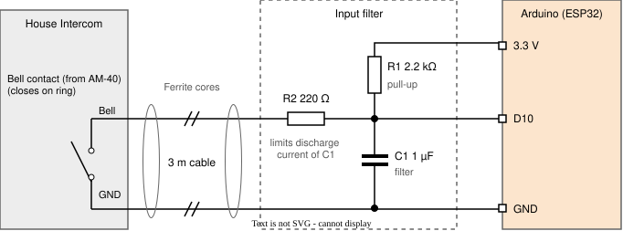
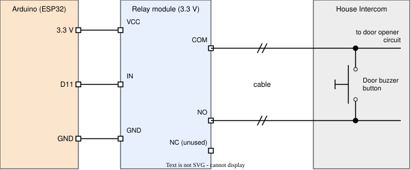

# Connection to the House Intercom

The device is connected to the house intercom via two signals: the bell signal (input) and the door buzzer (output). For the overall wiring and the GPIO assignment, see [`system-sketch.md`](system-sketch.md). In my case, the intercom is an [STR HT-40 ("Haustelefon 40")](https://www.str-elektronik.de/produkte/innenstationen/audio-innenstationen-qwikbus/ht40-qwikbus-audio-haustelefon-mit-hoerer).

## Bell signal (input)

The bell contact of the intercom's connection module ("Anschlussmodul 40") pulls the input `D10` to GND while the bell rings. The contact is about 3 m away from the Arduino, and a plain pull-up on such a long cable picks up enough interference to trigger false rings. A small filter on a perfboard close to the Arduino fixes this:

On ring, the contact pulls D10 LOW (≈ 0.3 V via R2/R1) and the firmware reads LOW as ring.
R2/C1 form a low-pass filter against spikes induced on the 3 m cable with a time constant of about (R1 ∥ R2) · C1 ≈ 0.2 ms, i.e. a cutoff frequency of roughly 800 Hz. Short spikes from the cable are smoothed out, while the bell signal itself, which lasts about 2 seconds, passes without noticeable delay. The ferrite cores at both cable ends keep high-frequency interference from getting onto the cable in the first place.

| Part | Value           | Purpose                                                                                                |
| ---- | --------------- | ------------------------------------------------------------------------------------------------------ |
| R1   | 2.2 kΩ          | Pull-up to 3.3 V; keeps `D10` HIGH while idle (low impedance compared to the internal pull-up)         |
| R2   | 220 Ω           | In series with the cable; limits the discharge current of C1 through the bell contact                  |
| C1   | 1 µF (ceramic)  | Together with R2 a low-pass filter that suppresses short spikes induced on the cable                   |
| –    | 2 ferrite cores | Clip-on, one at each end of the 3 m cable; suppress high-frequency interference picked up by the cable |

While ringing, `D10` is at ≈ 0.3 V (voltage divider R2/R1), clearly below the LOW threshold of the ESP32. On top of the hardware filter, the firmware debounces the input for 500 ms (`InputDebounceCycles` in [`gpioConfig.h`](../device-arduino/gpioConfig.h)).

## Door buzzer (output)

The door buzzer is triggered by an external 3.3 V relay module driven by `D11`. The relay's normally open contact (COM–NO) is wired in parallel to the door buzzer button of the intercom, so closing the relay has the same effect as pressing the button. Because the relay contact is potential-free, the intercom circuit stays isolated from the Arduino.

D11 HIGH switches the relay on for 5 s. The relay contact is potential-free, so the intercom circuit stays isolated from the Arduino. 

| Part         | Purpose                                                                                                                                                                                                                                                                       |
| ------------ | ----------------------------------------------------------------------------------------------------------------------------------------------------------------------------------------------------------------------------------------------------------------------------- |
| Relay module | 1-channel 3.3 V relay module with high-level trigger and optocoupler input, e.g. [this one on Amazon](https://www.amazon.de/1-Kanal-Relais-Netzschaltermodul-High-Level-Trigger-Optokoppler-Optoisolierung-ESP8266-Entwicklungsboard/dp/B0CN1C1S7Y); powered from the Arduino |
| 2-wire cable | Connects COM and NO in parallel to the door buzzer button                                                                                                                                                                                                                     |

When the door shall be opened, the firmware sets `D11` HIGH for 5 s (`DoorOpenTimeMs` in [`timing.h`](../device-arduino/timing.h)). The code never switches the buzzer relay and the external bell relay at the same time, to limit the current drawn from the 3.3 V supply.
