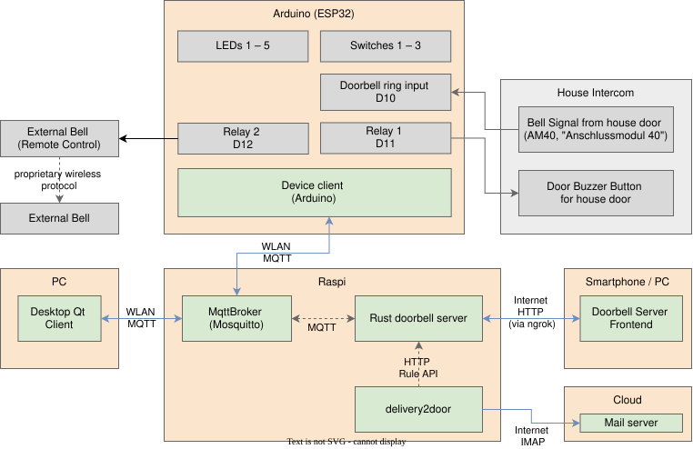

# Doorbell System Sketch

This file shows an overview of how the hardware is wired and how the different components of the system interact.

For the MQTT protocol used between the device and its controllers, see [`mqtt-contract.md`](mqtt-contract.md).


## System overview

* The Arduino (C++ client on ESP32) connects to the house intercom (door buzzer button and bell signal) and the external bell. It communicates with the doorbell server on the Raspi via MQTT.
* The Qt desktop client shows the "Ring" popups and communicates with the device via the MQTT broker on the Raspi.
* The Rust doorbell server contains an HTTP server for remote administration from the internet and an API for external services.
* External services like delivery2door communicate with the API of the doorbell server. This service scans incoming mails for delivery notifications and creates appropriate auto-buzz rules.

A detailed explanation of the components is given in the [readme.md](../readme.md) file.



Additionally to this there is an emulated device, a console application emulating the Arduino client for simulating rings and showing the auto-buzz state, connecting to a local MQTT broker.

## Front panel

Five status LEDs and three push buttons on the device enclosure:

```
┌─────────────────────────────────────────────────────────────────────────┐
│                                                                         │
│    LED 1    LED 2    LED 3    LED 4    LED 5       Sw 1   Sw 2   Sw 3   │
│     blue    green    orange    red     white                            │
│     (●)      (●)      (●)      (●)      (●)        (o)    (o)    (o)    │
│      D2       D3       D4       D5       D6         D7     D8     D9    │
│                                                                         │
└─────────────────────────────────────────────────────────────────────────┘
```

## GPIO assignment

| GPIO  | Device           | Function                                                                        | Constant          |
| ----- | ---------------- | ------------------------------------------------------------------------------- | ----------------- |
| –     | Internal LED     | Blinks: during start-up<br>Off: afterwards                                      | –                 |
| `D2`  | LED 1 (blue)     | On: Device on and ready                                                         | `LedDeviceOn`     |
| `D3`  | LED 2 (green)    | On for 1 s: Ack received, On: auto-buzz active                                  | `LedAckAutobuzz`  |
| `D4`  | LED 3 (orange)   | On: An auto-buzz rule on the server is active                                   | `LedRuleAutobuzz` |
| `D5`  | LED 4 (red)      | On: Error<br>On for 1 s: Unavailable button pressed<br>Blinks: Scheduled reboot | `LedError`        |
| `D6`  | LED 5 (white)    | Blinks: Recent door ring detected<br>On: Old, non-acknowledged door ring        | `LedDoorbell`     |
| `D7`  | Switch 1         | Switch auto-buzz mode                                                           | `SwitchBuzzmode`  |
| `D8`  | Switch 2         | Acknowledge ring and buzz                                                       | `SwitchAckBuzz`   |
| `D9`  | Switch 3         | Acknowledge ring                                                                | `SwitchAck`       |
| –     | Switch 1 & 2 & 3 | Reboot                                                                          | –                 |
| `D10` | (wired to AM40)  | Input bell                                                                      | `InputRing`       |
| `D11` | Relay 1          | Output buzzer                                                                   | `RelayBuzzer`     |
| `D12` | Relay 2          | Output external bell                                                            | `RelayExtBell`    |

The pin assignment is encoded in [`device-arduino/gpioConfig.h`](../device-arduino/gpioConfig.h).


## Hardware specification

* The wiring between Arduino and external components is shown in [`connection-to-intercom.md`](connection-to-intercom.md).
* The bill of materials for the project is listed in [`bill-of-materials.md`](bill-of-materials.md).