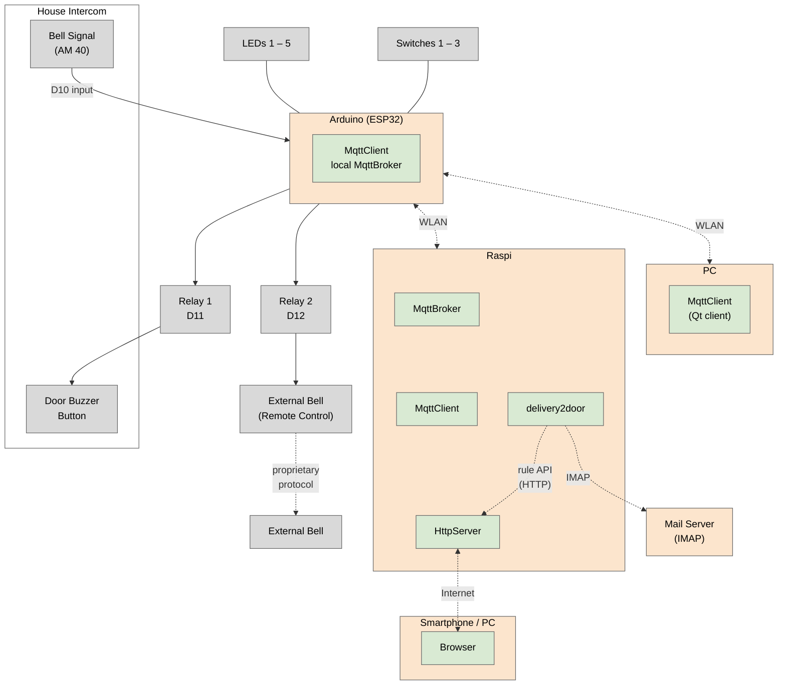

# Doorbell System Sketch

How the hardware is wired and how the pieces of the system fit together. The pin assignment
below mirrors [`broker-arduino/gpioConfig.h`](../broker-arduino/gpioConfig.h), which is the
**source of truth** — when a pin changes there, change it here too.

For the MQTT protocol spoken between the device and its controllers, see
[`mqtt-contract.md`](mqtt-contract.md).

## Front panel

Five status LEDs and three push buttons on the device enclosure:

```
┌─────────────────────────────────────────────────────────────────────────┐
│                                                                         │
│    LED 1    LED 2    LED 3    LED 4    LED 5       Sw 1   Sw 2   Sw 3   │
│     blue    green    orange    red     white                            │
│     (●)      (●)      (●)      (●)      (○)        (o)    (o)    (o)    │
│      D2       D3       D4       D5       D6         D7     D8     D9    │
│                                                                         │
└─────────────────────────────────────────────────────────────────────────┘
```

## GPIO assignment

| GPIO  | Device           | Function                                                                  | Constant          |
| ----- | ---------------- | ------------------------------------------------------------------------- | ----------------- |
| –     | Internal LED     | Always on                                                                 | –                 |
| `D2`  | LED 1 (blue)     | Device on and ready                                                       | `LedDeviceOn`     |
| `D3`  | LED 2 (green)    | (on for 1 s) Ack received<br>(on) Auto-buzzer active                      | `LedAckAutobuzz`  |
| `D4`  | LED 3 (orange)   | (on) A rule on the server is armed to buzz on a ring                      | `LedRuleAutobuzz` |
| `D5`  | LED 4 (red)      | Error                                                                     | `LedError`        |
| `D6`  | LED 5 (white)    | (blink) Recent door ring detected<br>(on) Old, non-acknowledged door ring | `LedDoorbell`     |
| `D7`  | Switch 1         | Switch auto-buzzer mode                                                   | `SwitchBuzzmode`  |
| `D8`  | Switch 2         | Acknowledge ring and buzz                                                 | `SwitchAckBuzz`   |
| `D9`  | Switch 3         | Acknowledge ring                                                          | `SwitchAck`       |
| –     | Switch 1 & 2 & 3 | Reboot                                                                    | –                 |
| `D10` | (wired to AM 40) | Input bell                                                                | `InputRing`       |
| `D11` | Relay 1          | Output buzzer                                                             | `RelayBuzzer`     |
| `D12` | Relay 2          | Output external bell                                                      | `RelayExtBell`    |

Debounce timings for the switches and the bell input are in the same header
(`SwitchDebounceCycles`, `InputDebounceCycles`).

## System overview

Solid lines are physical wiring, dotted lines are wireless / protocol hops.



Grey = hardware peripherals, green = software components, peach = hosts.

## Signal paths

- **Ring.** The intercom's bell signal (AM 40) pulls `D10` (`InputRing`); after debouncing, the
  device publishes the ring on MQTT.
- **Buzz (open the door).** Relay 1 on `D11` closes the intercom's door-buzzer button contact.
  It is triggered by switch 2 on the panel, by a `buzz` command over MQTT, or automatically on a
  ring when auto-buzzer mode is on.
- **Rule auto-buzz indicator.** LED 3 on `D4` (`LedRuleAutobuzz`) shows that a rule on the
  server is armed to buzz on the next ring. The server pushes this state over MQTT
  (`ruleAutoBuzzOn`/`ruleAutoBuzzOff`); the device only displays it and does not buzz on it -
  the buzz comes from the server as a `buzz` command. The state is not persisted on the device,
  the server re-sends it after every reconnect.
- **External bell.** Relay 2 on `D12` drives the remote control of a wireless door bell, which
  reaches the actual chime over its own proprietary radio protocol.
- **Remote control.** The Raspi runs the Rust server ([`server/`](../server)): an `MqttClient`
  talking to the device and an `HttpServer` exposing the web UI to a browser over the internet.
  The Qt client on a PC ([`client/`](../client)) connects to the same broker. What they exchange
  is specified in [`mqtt-contract.md`](mqtt-contract.md).
- **Delivery auto-buzz.** [`delivery2door/`](../delivery2door), also on the Raspi, polls a mail
  folder over IMAP for delivery announcements. For each announced delivery window it creates a
  rule in the server via its token-protected rule API (`/api/rules`); from then on the server arms
  the device like for any other rule (see *Rule auto-buzz indicator*). The rule deletes itself
  once the window has ended.
